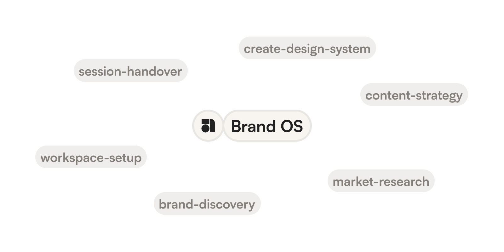

# Brand OS

Brand OS is a modular brand operating system. It structures brand intelligence across the tools founders already use, so the brand becomes something the team can speak with, filter decisions through, and create from at scale. A living system that compounds as the brand grows.

This version ships the brand's foundation, its first working layer and its visual identity: workspace configuration, a knowledge base built through guided discovery, skills that put the brand to work in daily decisions and content, and a brand folder any person or agent can build from.

---

## Modules

### Core

The brand's base layer. Core configures your agent workspace, sets the brand's personality, and maintains continuity across sessions. You start here. The brand becomes present, responsive, and yours.

*Skills: workspace-setup, agent-persona, session-handover*

&nbsp;

### Memory

Your brand intelligence begins compounding. Memory is the brand's living record across eleven dimensions, held in the knowledge base. New hires onboard from it. Agents read from it. You stop re-explaining everything from scratch.

*Skills: brand-discovery*

*Resources: [Knowledge Base](https://www.notion.com/templates/brand-knowledge-base?clientBuildTarget=client)*

*Connections: Notion*

&nbsp;

### Worldview

The brand develops conviction and starts acting on it. Worldview runs on the knowledge base: filter any decision through the documented brand, generate content in its voice, and package brand context for a designer, a collaborator, or another AI tool. The instincts you carry become judgment your team can use without you in the room.

*Skills: brand-filter, on-voice, brand-brief*

&nbsp;

### Identity

The brand takes a visible form. Identity turns what the knowledge base holds into color, type, motifs and motion, each decided with you in rounds you can see. It then assembles a brand folder: a design standard in Google Labs' DESIGN.md format, a token library your code can install, and a standards sheet generated from those tokens. An identity a designer already made is packaged the same way, as it was delivered.

*Skills: visual-identity, design-tokens, design-md, brand-library*

*Agents: design-director*

*Connections: Figma, optional*

---

## Getting Started

You need an agent environment that supports skills (`.claude/skills/` or equivalent). The knowledge base lives in the storage you choose: Notion or a local markdown folder.

Brand OS runs on any harness that supports the Agent Skills format. Claude-specific features (AskUserQuestion widgets, MCP connections) are optional enhancements with a documented fallback.

### Option A: Cowork plugin (Claude desktop app)

**[Download the latest release](https://github.com/Atmo-Studio/brand-os/releases/latest)** — grab the `.plugin` asset.

Drag `brand-os.plugin` into Cowork's plugin browser or use **Install from file**. Skills load automatically. Skip to [Set up the Knowledge Base](#set-up-the-knowledge-base).

### Option B: Universal (manual)

Copy the contents of the Brand OS folder into your agent's configuration folder, `.claude/` for most harnesses, so `skills/` lands in its skills directory and `SOUL.md` sits beside it. Keep the layout: the skills read their writing rules from `SOUL.md` two folders up, so a skill copied or linked on its own loses them.

Brand OS also ships a baseline agent character in `SOUL.md`. If you don't already have your own agent workspace, copy `SOUL.md` into your agent's workspace-level context so the skills have a personality layer to run on. If you already have a CLAUDE.md/AGENTS.md of your own, skip this: your setup takes precedence and the skills layer on top.

**workspace-setup** will detect which mode you're in and adapt accordingly.

### Connect Notion

Add the Notion MCP to your agent settings. Most harnesses have a first-party MCP settings menu. Search for "Notion" and follow the prompts.

Only if your agent has **no** built-in Notion connector, add the Notion MCP server (`@notionhq/notion-mcp-server`) to *your agent's own* MCP config, using a token from [notion.so/my-integrations](https://www.notion.so/my-integrations).

> ⚠️ **Do not create a `.mcp.json` file inside the plugin folder.** Some agents auto-load it, and a config with a placeholder token will silently override a Notion connection you already have working, breaking it with no obvious cause. Configure Notion in your agent's own settings, not in the plugin.

### Set up the Knowledge Base

→ [Open the Knowledge Base template](https://www.notion.com/templates/brand-knowledge-base?clientBuildTarget=client)

Press **Duplicate** to add it to your Notion workspace. You don't need to copy any IDs by hand. **brand-discovery** finds the database, verifies it, and records the ID for you.

### Start

Run **workspace-setup** to configure your agent environment (optional if you already have one). Then run **brand-discovery** to connect your storage and begin building your brand's memory. Once the knowledge base is complete, the Worldview skills run on it: **brand-filter**, **on-voice**, and **brand-brief**. When you are ready for the brand's look, run **visual-identity**. It starts from what discovery recorded and ends in a `brand/` folder in your project.

The Identity skills build and check their files with Node.js 18 or later, and print the standards sheet with a Chromium-family browser such as Chrome. Where either is missing, the skill says what it could not make and carries on.

---

## Changelog

See [CHANGELOG.md](./CHANGELOG.md) for full release notes.

---

## About

Built by [Atmo Studio](https://atmo.studio). Brand OS is an Atmo product.

Stuck, or need something Brand OS doesn't cover? Email hello@atmo.studio.

## License

**MIT** — see [LICENSE](./LICENSE). Free to use, modify, and build on.
